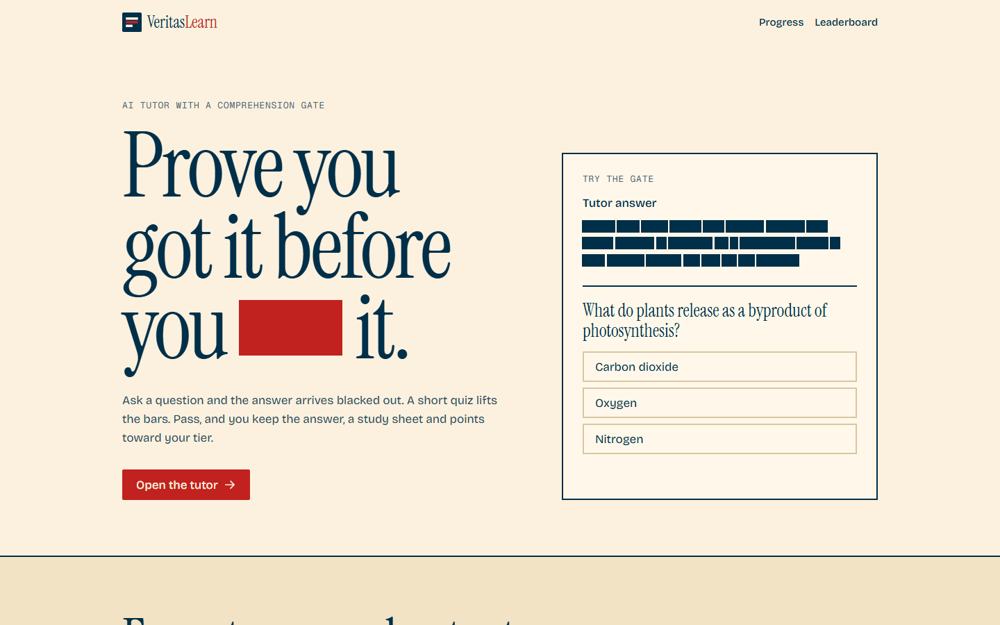
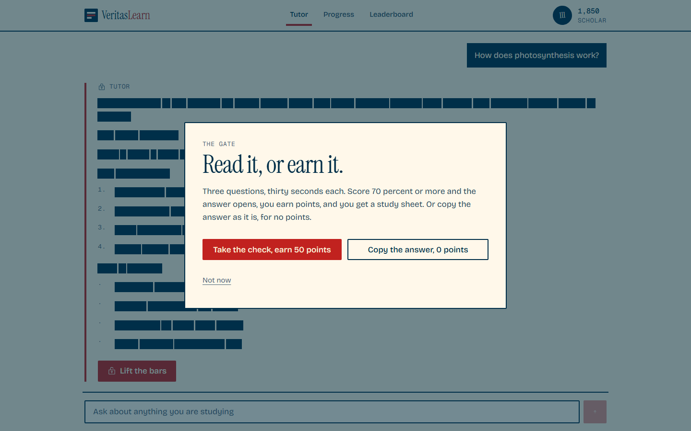
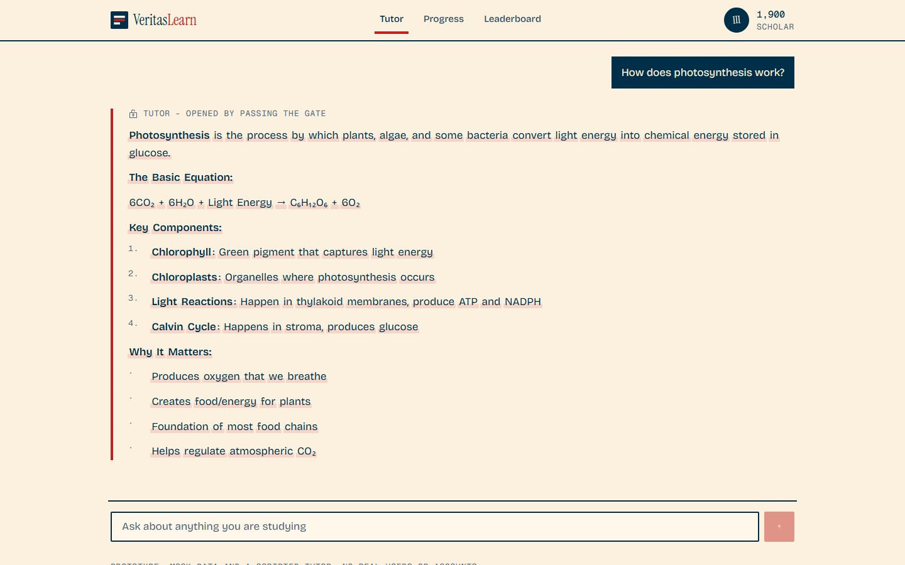

# VeritasLearn

**An AI tutor that makes you earn the answer: it stays hidden behind censor bars until you prove you understood it.**

[](https://veritaslearn-gamma.vercel.app)
[](https://github.com/FARUKxKUN/VeritasLearn/actions/workflows/ci.yml)


**1st place at the IEEE OPSYNC hackathon (February 2026).** Redesigned in October 2026. The version presented at the hackathon is tagged [`hackathon-2026-02`](https://github.com/FARUKxKUN/VeritasLearn/tree/hackathon-2026-02).



---

## The problem

Students paste AI answers into their work without reading them. They hand in content they could not explain, and learn nothing from it. Blocking AI does not work; the answer is already one tab away.

## The idea

Keep the AI, but make understanding the price of the answer. You ask the tutor anything, and the answer arrives with its key words blacked out. To lift the bars you pass a short quiz on what the answer just taught. Pass, and the answer is yours, along with XP and a study sheet. Fail, and it stays locked.

## How it plays

1. **Ask.** Type any question; the tutor writes a full answer.
2. **Hidden.** The answer appears behind censor bars, word by word. You can see it exists, not what it says.
3. **Beat the quiz.** Three questions, thirty seconds each. 70 percent opens the answer. Retries are capped.
4. **Level up.** The bars lift, you get flashcards and study material, and your XP climbs through six tiers: Seeker, Explorer, Scholar, Master, Legend, Titan.



## Highlights

- **A game loop, not a lecture.** A mascot, XP pop-ups, a tier ladder and campus and national leaderboards with a podium make the gate something you want to beat.
- **Playable from the landing page.** A one-question gate in the hero lets visitors try the mechanic before entering the app.
- **The redacted answer as the hero object.** The censor bar is the brand: it appears in the logo, the headline and the tutor.
- **Motion with care.** Animations respect `prefers-reduced-motion`, and the quiz timer, sheet dismissal and retry cap were hardened after review.



## Tech stack

| Layer | Technology |
|---|---|
| App | React 18, TypeScript, Vite |
| Routing | React Router: `/`, `/learn`, `/dashboard`, `/leaderboard` |
| State | React context for score, tier, stats, activity and chat |
| Styling | Tailwind CSS v4 with CSS-first design tokens |
| Motion | motion (springs, score pop-ups, confetti) and GSAP ScrollTrigger (pinned how-it-works) |
| Icons and type | Phosphor icons, Bricolage Grotesque (self-hosted) |
| Hosting | Vercel |

## Project structure

```
src/
  pages/            LandingPage, ChatPage, DashboardPage, LeaderboardPage
  components/
    landing/        Hero, MiniGate, HowItWorks, TierLadder, Paths, Footer
    chat/           ChatInterface, RedactedAnswer
    quiz/           ComprehensionGate, QuizInterface, QuizResults, Flashcards, StudyMaterials
    ui/             Mascot, Meter, ScorePopup, Confetti, Sheet, Tabs and other primitives
  contexts/         AppContext (score, tier, stats, messages)
  utils/            tiers.ts (XP thresholds), mockData.ts (answers, quizzes, leaderboards)
```

## Run locally

```bash
npm install
npm run dev     # http://localhost:5173
npm run build   # type check + production build
```

No sign-up or account is needed in the prototype.

## Status

This is the clickable prototype, redesigned. The tutor's answers, quizzes, scores and leaderboards are mock data in the browser: there is no model call and no back end yet. Wiring a real LLM would mean generating the answer, the redaction and the quiz from the same response.

## Team

| | Role |
|---|---|
| [Rayen Chatti](https://github.com/rayenchatti) | Concept, pitch deck design |
| [Yassine Bouteraa](https://github.com/yassinebouteraa) | Concept, pitch deck design, pitch |
| **Farouk Battikh** ([@FARUKxKUN](https://github.com/FARUKxKUN)) | Prototype and its redesign, pitch |

## License

No license is granted. All rights reserved by the team.
